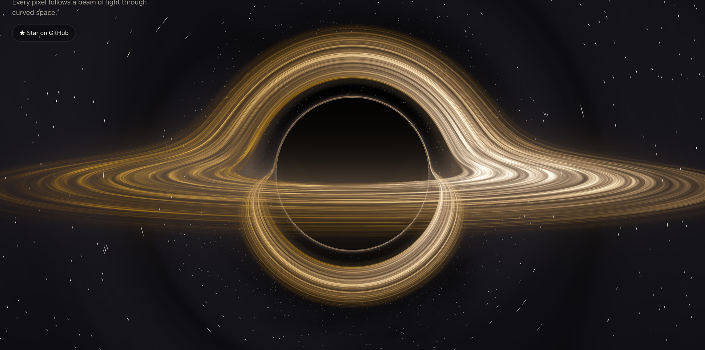
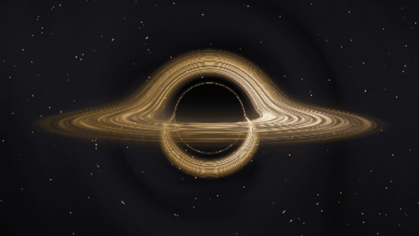

<h1 align="center">event horizon</h1>

<p align="center"><b>A black hole, ray-traced live in your browser. One HTML tag, zero dependencies.</b></p>

<p align="center">
  <a href="https://milesgurule-png.github.io/event-horizon/"></a>
</p>

<p align="center">
  <a href="https://milesgurule-png.github.io/event-horizon/"></a>
</p>

<p align="center">
  <a href="https://milesgurule-png.github.io/event-horizon/"><b>Live demo</b></a> ·
  <a href="#use-it">Use it</a> ·
  <a href="#how-it-works">How it works</a> ·
  <a href="#options">Options</a>
</p>

---

Every pixel fires a ray of light backwards from the camera and follows it through the curved space around a black hole.
Where the ray crosses the glowing disk of gas, that light is added. Where it falls past the event horizon, nothing comes
back. Where it escapes, it picks up the stars behind, bent by gravity.

The arch of light over the top of the black hole and the thin ring hugging it aren't drawn on. They're the far side of
the disk, seen through light that gravity has bent around the hole. They fall out of the physics.

- **Real physics:** light paths integrated through Schwarzschild spacetime (RK4), a thin accretion disk with a
  blackbody temperature profile, relativistic beaming and gravitational redshift, and a gravitationally lensed sky.
- **One tag:** a standard web component. Works in plain HTML, React, Vue, Svelte, anything.
- **Small:** one 29 KB file (10 KB gzipped), no dependencies, no build step.
- **Sharp at full resolution, and fast:** the bent light paths only depend on where the camera is, so when the camera
  holds still they're traced once at your screen's native resolution (a strip at a time, under a second) and every frame
  after that just re-shades the moving gas and stars, fine filaments included. A native Retina image (3024x1890) costs
  about 5 ms of GPU time per frame on an M-series MacBook. While you drag or dive, a fast live tracer takes over and the image re-sharpens when you stop.
- **Polite:** only renders while it's on screen, pauses in background tabs, shows a still frame for people who prefer
  reduced motion, and falls back to a CSS glow without WebGL.

## Use it

```html
<script src="https://cdn.jsdelivr.net/gh/milesgurule-png/event-horizon@1/black-hole.js"></script>

<black-hole style="height: 70vh" interactive></black-hole>
```

That's it. Give it a size like any block element.

**Pinned + verified (recommended for production):** load an exact release so the file can never change under you, and
add Subresource Integrity (this hash is for v1.1.0; each
[release](https://github.com/milesgurule-png/event-horizon/releases) lists its own).

```html
<script src="https://cdn.jsdelivr.net/gh/milesgurule-png/event-horizon@1.1.0/black-hole.js"
        integrity="sha384-JtB+4LsbwFQVVMW8BETR8wxbuOkUQ26+pRLqTRMVVEI3Ad+SQyn+HwiZ3RdRbXNz" crossorigin="anonymous"></script>
```

Or download [`black-hole.js`](black-hole.js) and serve it yourself.

## Options

All options are HTML attributes, and you can change them live with `setAttribute`.

| Attribute | Default | What it does |
|---|---|---|
| `palette` | `ember` | `ember`, `interstellar`, `ice`, `true` (physically based colour), `mono` |
| `distance` | `30` | Camera distance, in Schwarzschild radii (the horizon is 1). Below ~5 you're inside the disk. |
| `inclination` | `8` | Camera height above the disk, in degrees. Near 0 gives the classic arched halo. |
| `azimuth` | `0` | Camera angle around the hole, in degrees. |
| `fov` | `38` | Field of view, in degrees. |
| `autorotate` | `0` | Degrees per second the camera orbits on its own. |
| `spin` | `1` | How fast the disk turns. |
| `doppler` | `0.85` | Relativistic beaming, 0 to 1: the side coming toward you is brighter and bluer. |
| `glow` | `1` | Haze around the disk and the photon ring. |
| `exposure` | `1.1` | Overall brightness. |
| `stars` | `1` | Background star field brightness (0 hides it). |
| `quality` | auto | `low`, `medium` or `high`: the live budget and the sharp image's pixel cap. Auto picks `low` on small screens. |
| `focus-x`, `focus-y` | `0.5` | Where the hole sits in the frame (0 to 1), to leave room for text. |
| `interactive` | off | Drag to orbit, pinch to zoom. A plain mouse wheel still scrolls the page. |
| `wheel-zoom` | off | Also zoom with the mouse wheel (for full-screen viewers). |
| `paused` | off | Freeze the animation. |

The camera is also available as properties: `el.distance = 4`, `el.inclination`, `el.azimuth`.

```js
// a slow fly-in when the section scrolls into view
const bh = document.querySelector('black-hole');
let d = 40;
(function fly() { d += (6 - d) * 0.02; bh.distance = d; if (d > 6.05) requestAnimationFrame(fly); })();
```

## How it works

<details>
<summary><b>The light paths</b></summary>

In units where the event horizon has radius 1, a ray of light moving through the space around a non-spinning black hole
feels an acceleration

```
a = -3/2 · h² · r / |r|⁵        h = |r × v|  (conserved along the ray)
```

which is the Schwarzschild orbit equation for light written in ordinary 3D coordinates. Each pixel's ray is stepped
forward with fourth-order Runge-Kutta, using long steps far from the hole and short ones near it. A ray that drops below
radius 1 has crossed the horizon. A ray that heads back out past the camera has escaped and samples the sky in its final
direction, which is what makes stars near the hole smear into arcs.
</details>

<details>
<summary><b>The disk</b></summary>

The disk lies flat between the innermost stable orbit (radius 3) and radius 12. Each time a ray crosses the disk plane,
the crossing point is found by interpolation and the disk's colour there is blended in. Rays can cross several times,
which is how the far side of the disk appears both above and below the shadow.

- **Temperature** follows the thin-disk profile `T ∝ x^(-3/4) · (1 - x^(-1/2))^(1/4)` (x = r / r_inner): zero at the
  inner edge, hottest just outside it, cooling outward. Colour comes from a blackbody fit.
- **Beaming:** gas orbits at up to half the speed of light. The side moving toward you is shifted brighter and bluer,
  the receding side dimmer and redder (Doppler factor times gravitational redshift).
- **Motion:** each ring of gas turns at its own Kepler speed. Neighbouring rings are blended rather than sheared, so the
  pattern never winds itself into noise however long the page stays open.
</details>

<details>
<summary><b>Performance</b></summary>

Tracing a light path costs hundreds of steps, but where a path goes depends only on the camera, not on time. So the
component has two modes:

- **Still camera (the sharp image):** paths are traced once at full screen resolution (native resolution up to about 6 million pixels,
  `quality="high"` allows 9 million) and stored: up to three disk crossings per pixel, the direction the escaping light
  leaves in, and the glow it gathered. This is done a strip per frame so nothing ever stalls. After that, each frame only
  re-shades the turning gas and the stars from the stored paths, which is cheap.
- **Moving camera:** a live tracer runs at a fixed pixel budget (about 230,000 pixels) and is scaled up, then the sharp
  image crossfades back in once the camera settles.

The slow `autorotate` orbit turns the disk and the sky instead of the camera. A non-spinning black hole looks the same
from every direction around its axis, so that's identical on screen and never forces a re-trace.

The sharp mode needs WebGL 2 with float render targets (every current desktop and mobile browser); older browsers get
the live tracer only. Rendering stops when the element leaves the screen or the tab is hidden.
</details>

## Credits

Written by [Miles Gurule](https://github.com/milesgurule-png). The physics is textbook general relativity; the code is
original. Visual touchstones: Kip Thorne and Double Negative's work on *Interstellar*, and Jean-Pierre Luminet's 1979
first image of a black hole's disk.

Released under the [MIT License](LICENSE). If you use it somewhere cool, open an issue and show me.
